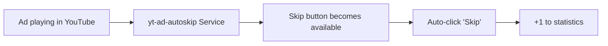

# yt-ad-autoskip

[](https://github.com/a-les/youtube-ad-autoskip/releases)
[](https://github.com/a-les/youtube-ad-autoskip/actions)
[-blue?style=flat-square)](https://developer.android.com/about/dashboards)
[-blue?style=flat-square)](https://developer.android.com/about/versions/14)
[-success?style=flat-square)](#security-and-privacy-model)
[](LICENSE)

<p align="center">
  <b>English</b> • <a href="README_RU.md">Русский</a>
</p>

An open-source Android accessibility service that automates clicking the "Skip Ad" button in the official YouTube and YouTube Music applications.

---

## Table of Contents

- [Overview](#overview)
- [Technical Capabilities](#technical-capabilities)
- [Architecture & Components](#architecture--components)
- [Technical Comparison](#technical-comparison)
- [Security and Privacy Model](#security-and-privacy-model)
- [Installation and Configuration](#installation-and-configuration)
  - [Prerequisites](#prerequisites)
  - [Enabling the Accessibility Service](#enabling-the-accessibility-service)
  - [Resolving Restricted Settings on Android 13+](#resolving-restricted-settings-on-android-13)
  - [OEM Battery Management](#oem-battery-management)
- [Building from Source](#building-from-source)
- [Repository Structure](#repository-structure)
- [License](#license)
- [Disclaimer](#disclaimer)

---

## Overview

Modern mobile video playback frequently introduces commercial interruptions. When direct device interaction is impractical (such as during cooking, driving, or workouts), waiting for the skip button and tapping it manually interrupts the viewing experience.

`yt-ad-autoskip` operates entirely at the OS accessibility layer:
1. It listens for window state and content transitions specifically dispatched by official YouTube packages (`com.google.android.youtube` and `com.google.android.apps.youtube.music`).
2. It detects the skip control as soon as it becomes available.
3. The service immediately dispatches `performAction(ACTION_CLICK)` directly on the corresponding node or its clickable parent container, skipping the commercial segment in under 50 milliseconds.

---

## Technical Capabilities

- **Deterministic Control Detection:** Scans the active view hierarchy using known resource identifiers (`skip_ad_button`, `modern_skip_ad_button`, `preskip_button`) and localized text identifiers across major languages.
- **Accurate Triggering:** Accurately identifies when the skip control becomes actionable, ensuring clean execution without premature or duplicate clicks.
- **Hierarchical Node Traversal:** Climbs parent `AccessibilityNodeInfo` references up to 4 levels if the target leaf node is wrapped in a non-clickable layout container.
- **Memory and Battery Efficiency:** Implements a passive, event-driven model. The service process remains idle in memory (`~16 MB RSS`), triggering evaluation cycles only when Android dispatches `TYPE_WINDOW_CONTENT_CHANGED` from the targeted package.
- **Persistent Metrics:** Tracks processed advertisement counts, uptime, and last recorded interaction timestamps via localized `SharedPreferences`.

---

## Architecture & Components



### Component Breakdown

| Component | Class | Description |
|---|---|---|
| Service Core | `YouTubeAutoSkipService` | Extends `AccessibilityService`. Handles event filtering, node inspection, recursive traversal, and click dispatch. |
| Configuration | `accessibility_service_config.xml` | Declares event flags (`typeWindowContentChanged`, `typeWindowStateChanged`) and targets packages `com.google.android.youtube` and `com.google.android.apps.youtube.music`. |
| Interface | `MainActivity` | Material 3 management console. Displays real-time service status, usage statistics, diagnostics, and preference toggles. |
| Persistence | `PreferencesManager` | Synchronizes user configurations and runtime metrics to private app storage. |

---

## Technical Comparison

| Criteria | Standard YouTube App | YouTube Premium | Third-Party Mods (ReVanced, etc.) | **yt-ad-autoskip** |
|---|:---:|:---:|:---:|:---:|
| **Official APK Intact** | Yes | Yes | No (requires modified third-party APK) | **Yes (Official YouTube)** |
| **Account Safety** | Native | Native | Third-party microG dependency risk | **Native (No account interaction)** |
| **Root Privileges** | Not required | Not required | Not required | **Not required** |
| **Network Access** | Full | Full | Full | **None (`0` network sockets)** |
| **System Overhead** | Base | Base | Background microG services | **Event-driven (< 20 MB RAM)** |
| **Automation** | None | Ad removal | Ad removal | **Automated skip dispatch** |

---

## Security and Privacy Model

`yt-ad-autoskip` is designed with a strict zero-trust, offline architecture:

1. **Absence of Network Permissions:** The manifest file explicitly omits `android.permission.INTERNET`. The application has no technical capability to establish socket connections, transmit telemetry, or exfiltrate on-screen data.
2. **Restricted Package Scope:** The accessibility configuration strictly limits event delivery to official YouTube application package names (`com.google.android.youtube` and `com.google.android.apps.youtube.music`). No other application activity can be inspected by this service.
3. **Local-Only Metrics:** All analytical values (such as skip counts and timestamps) reside within local private app storage (`/data/data/com.autoskip.yt/shared_prefs/`).

### Declared Permissions

| Permission | Usage |
|---|---|
| `android.permission.BIND_ACCESSIBILITY_SERVICE` | Required by the operating system to bind `YouTubeAutoSkipService` and inspect targeted UI node hierarchies. |

---

## Installation and Configuration

### Prerequisites

- Android 7.0 (API Level 24) or higher.
- Official YouTube or YouTube Music app installed from Google Play or system image.

### Enabling the Accessibility Service

1. Download the latest `yt-ad-autoskip-v1.0.0.apk` from the [Releases](https://github.com/a-les/youtube-ad-autoskip/releases) section.
2. Sideload and install the APK on your device.
3. Launch **yt-ad-autoskip** and select **Start Service** (or navigate to **Settings → Accessibility**).
4. Under **Downloaded apps** (or **Installed services**), select **yt-ad-autoskip Service**.
5. Enable the toggle and confirm the system dialog.
6. Verify that the application status changes to **Working**.

### Resolving Restricted Settings on Android 13+

Starting with Android 13, the operating system blocks sideloaded applications from acquiring accessibility permissions by default. If the accessibility toggle appears disabled or displays *"Restricted setting"*:

1. Navigate to **System Settings → Apps → All apps → yt-ad-autoskip**.
2. Tap the three-dot overflow menu (**⋮**) in the top right corner.
3. Select **Allow restricted settings**.
4. Authenticate using your device PIN, pattern, or biometric prompt.
5. Return to **Accessibility → yt-ad-autoskip Service** to enable the service.

### OEM Battery Management

Certain OEM firmware implementations (MIUI/HyperOS, EMUI, OneUI) employ aggressive background execution managers that may terminate inactive accessibility bindings:

- **Battery Optimization:** In app info, configure battery usage to **Unrestricted** (or disable power saving restrictions).
- **Auto-start (Xiaomi / HyperOS):** Ensure the **Autostart** toggle is permitted under app details.

---

## Building from Source

### Requirements

- Android Studio Hedgehog (2023.1.1) or newer, or standalone Gradle CLI.
- Java Development Kit (JDK) 17.
- Android SDK Platform 34 and Build Tools 34.0.0.

### Compilation

```bash
# Clone the repository
git clone https://github.com/a-les/youtube-ad-autoskip.git
cd youtube-ad-autoskip

# Assemble Debug APK (Windows PowerShell)
.\gradlew.bat assembleDebug

# Assemble Debug APK (Linux / macOS)
chmod +x gradlew
./gradlew assembleDebug
```

The compiled binary will be located at:
```text
app/build/outputs/apk/debug/app-debug.apk
```

---

## Repository Structure

```text
youtube-ad-autoskip/
├── .github/
│   └── workflows/
│       └── build.yml               # Automated CI build and release pipeline
├── app/
│   ├── src/
│   │   └── main/
│   │       ├── java/com/autoskip/yt/
│   │       │   ├── MainActivity.kt               # UI controller and diagnostics
│   │       │   ├── PreferencesManager.kt         # Persistent storage abstraction
│   │       │   └── YouTubeAutoSkipService.kt     # Accessibility automation service
│   │       ├── res/                              # Layouts, vector assets, and resources
│   │       └── AndroidManifest.xml               # Component and permission declarations
│   ├── build.gradle.kts                          # Module build script
│   └── proguard-rules.pro                        # Code obfuscation and keep rules
├── build.gradle.kts                              # Root build configuration
├── gradle.properties                             # JVM flags and AndroidX flags
└── settings.gradle.kts                           # Module and repository definitions
```

---

## License

This project is licensed under the [MIT License](LICENSE).

## Disclaimer

`yt-ad-autoskip` is an independent open-source utility developed for accessibility automation purposes. It is not affiliated with, authorized, maintained, sponsored, or endorsed by YouTube, Google LLC, or any of their affiliates. All registered trademarks belong to their respective owners.
