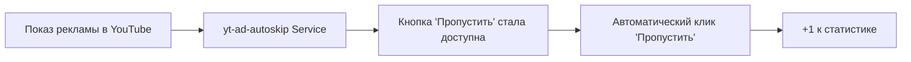

# yt-ad-autoskip

[](https://github.com/a-les/youtube-ad-autoskip/releases)
[](https://github.com/a-les/youtube-ad-autoskip/actions)
[-blue?style=flat-square)](https://developer.android.com/about/dashboards)
[-blue?style=flat-square)](https://developer.android.com/about/versions/14)
[-success?style=flat-square)](#модель-безопасности-и-конфиденциальности)
[](LICENSE)

<p align="center">
  <a href="README.md">English</a> • <b>Русский</b>
</p>

Автономный сервис специальных возможностей (Accessibility Service) для Android с открытым исходным кодом, предназначенный для автоматического нажатия кнопки «Пропустить» при показе рекламы в официальных приложениях YouTube и YouTube Music.

---

## Содержание

- [Обзор](#обзор)
- [Технические возможности](#технические-возможности)
- [Архитектура и компоненты](#архитектура-и-компоненты)
- [Сравнительный анализ](#сравнительный-анализ)
- [Модель безопасности и конфиденциальности](#модель-безопасности-и-конфиденциальности)
- [Установка и настройка](#установка-и-настройка)
  - [Системные требования](#системные-требования)
  - [Включение службы специальных возможностей](#включение-службы-специальных-возможностей)
  - [Снятие системных ограничений на Android 13+](#снятие-системных-ограничений-на-android-13)
  - [Фоновая оптимизация OEM-прошивок](#фоновая-оптимизация-oem-прошивок)
- [Сборка из исходного кода](#сборка-из-исходного-кода)
- [Структура репозитория](#структура-репозитория)
- [Лицензия](#лицензия)
- [Отказ от ответственности](#отказ-от-ответственности)

---

## Обзор

При воспроизведении видео на мобильных устройствах пользователи регулярно сталкиваются с рекламными роликами. В ситуациях, исключающих постоянный ручной контакт с экраном (приготовление пищи, вождение автомобиля, спортивные тренировки), необходимость ждать появления кнопки пропуска и нажимать её вручную прерывает просмотр.

Проект `yt-ad-autoskip` функционирует на уровне системного API специальных возможностей Android:
1. Сервис осуществляет мониторинг событий изменения содержимого окон (`TYPE_WINDOW_CONTENT_CHANGED`), поступающих исключительно от официальных пакетов `com.google.android.youtube` и `com.google.android.apps.youtube.music`.
2. Сервис мгновенно определяет появление кнопки пропуска, как только она становится доступной.
3. Сервис выполняет действие `performAction(ACTION_CLICK)` на целевом элементе интерфейса или его кликабельном родительском контейнере, пропуская рекламный ролик за доли секунды.

---

## Технические возможности

- **Детерминированное определение кнопки пропуска:** Сканирование дерева интерфейса по внутренним идентификаторам (`skip_ad_button`, `modern_skip_ad_button`, `preskip_button`) и текстовым строкам («Пропустить», «Skip» и др.) на разных языках.
- **Точное срабатывание:** Сервис отслеживает момент, когда кнопка пропуска становится доступной для нажатия, исключая преждевременные или ложные срабатывания.
- **Иерархический обход узлов:** Если кнопка обёрнута в некликабельный контейнер, сервис автоматически поднимается по родительским элементам (до 4 уровней) до нахождения активного кликабельного компонента.
- **Низкие накладные расходы:** Архитектура построена на реактивной событийной модели. Процесс не использует постоянных фоновых таймеров и потребляет около `16 МБ RAM`.
- **Локальная статистика:** Учет количества обработанных роликов и времени работы службы с сохранением в закрытом локальном хранилище.

---

## Архитектура и компоненты



### Основные компоненты

| Компонент | Класс | Назначение |
|---|---|---|
| Ядро службы | `YouTubeAutoSkipService` | Наследник `AccessibilityService`. Управляет жизненным циклом, фильтрацией событий, анализом нод и кликом. |
| Конфигурация | `accessibility_service_config.xml` | Декларирует флаги `typeWindowContentChanged` и фильтрацию пакетов `com.google.android.youtube` и `com.google.android.apps.youtube.music`. |
| Интерфейс | `MainActivity` | Консоль управления Material 3. Отображает статус службы, статистику, переключатели и системную диагностику. |
| Хранилище | `PreferencesManager` | Синхронизация пользовательских параметров и счётчиков в закрытое локальное хранилище приложения. |

---

## Сравнительный анализ

| Критерий | Штатный YouTube | YouTube Premium | Сторонние моды (ReVanced и др.) | **yt-ad-autoskip** |
|---|:---:|:---:|:---:|:---:|
| **Оригинальное приложение** | Да | Да | Нет (взломанный сторонний APK) | **Да (Штатный YouTube)** |
| **Безопасность Google-аккаунта** | Полная | Полная | Риск (требует сторонний microG) | **Полная (аккаунт не затрагивается)** |
| **Root-права** | Не требуются | Не требуются | Не требуются | **Не требуются** |
| **Доступ в интернет** | Полный | Полный | Полный | **Отсутствует (0 сетевых прав)** |
| **Потребление ресурсов** | Базовое | Базовое | Фоновые процессы microG | **Реактивное (< 20 МБ RAM)** |
| **Автоматизация** | Нет | Отсутствие рекламы | Отсутствие рекламы | **Автоматическое нажатие «Пропустить»** |

---

## Модель безопасности и конфиденциальности

Архитектура проекта строго изолирована от внешних коммуникаций:

1. **Полное отсутствие сетевых разрешений:** В файле `AndroidManifest.xml` отсутствует директива `android.permission.INTERNET`. Приложение не может создавать сетевые подключения и передавать какую-либо информацию во внешнюю среду.
2. **Ограничение области видимости:** Служба специальных возможностей обрабатывает события только от официальных пакетов `com.google.android.youtube` и `com.google.android.apps.youtube.music`. Взаимодействие с остальными приложениями заблокировано конфигурацией сервиса.
3. **Локальное хранение данных:** Вся статистика хранится исключительно во внутреннем изолированном каталоге устройства (`/data/data/com.autoskip.yt/shared_prefs/`).

### Запрашиваемые системные разрешения

| Разрешение | Назначение |
|---|---|
| `android.permission.BIND_ACCESSIBILITY_SERVICE` | Требуется операционной системой для привязки службы и анализа дерева интерфейса целевых приложений. |

---

## Установка и настройка

### Системные требования

- Android 7.0 (API Level 24) или новее.
- Установленное официальное приложение YouTube или YouTube Music.

### Включение службы специальных возможностей

1. Загрузите файл `yt-ad-autoskip-v1.0.0.apk` из раздела [Releases](https://github.com/a-les/youtube-ad-autoskip/releases).
2. Выполните установку APK на целевое устройство.
3. Откройте **yt-ad-autoskip** и нажмите **«Запустить службу»** (или перейдите в *Настройки → Специальные возможности*).
4. В категории **«Скачанные приложения»** (или *«Установленные службы»*) выберите **yt-ad-autoskip Service**.
5. Активируйте переключатель и подтвердите системный запрос.
6. Убедитесь, что статус в приложении изменился на **«Работает»**.

### Снятие системных ограничений на Android 13+

В операционных системах Android 13 и новее для приложений, установленных не из официального магазина, доступ к специальным возможностям по умолчанию заблокирован (*«Ограниченные настройки»*):

1. Откройте **Настройки** → **Приложения** → **Все приложения** → **yt-ad-autoskip**.
2. В правом верхнем углу нажмите меню из трех точек (**⋮**).
3. Выберите пункт **«Разрешить ограниченные настройки»** (или *«Удалить ограничения в настройках»*).
4. Подтвердите действие с помощью PIN-кода или биометрической аутентификации.
5. Вернитесь в меню *Специальные возможности → yt-ad-autoskip Service* и включите службу.

### Фоновая оптимизация OEM-прошивок

Агрессивные алгоритмы энергосбережения ряда прошивок (HyperOS/MIUI, EMUI, OneUI) могут завершать фоновые службы:

- **Контроль активности батареи:** В свойствах приложения установите параметр *«Без ограничений»*.
- **Автозапуск (Xiaomi / HyperOS):** Активируйте переключатель *«Автозапуск»* в карточке приложения.

---

## Сборка из исходного кода

### Требования к окружению

- Android Studio Hedgehog (2023.1.1) или новее / Gradle CLI.
- Java Development Kit (JDK) 17.
- Android SDK Platform 34 и Build Tools 34.0.0.

### Компиляция

```bash
# Клонирование репозитория
git clone https://github.com/a-les/youtube-ad-autoskip.git
cd youtube-ad-autoskip

# Сборка Debug APK (Windows PowerShell)
.\gradlew.bat assembleDebug

# Сборка Debug APK (Linux / macOS)
chmod +x gradlew
./gradlew assembleDebug
```

Собранный исполняемый файл будет доступен по пути:
```text
app/build/outputs/apk/debug/app-debug.apk
```

---

## Структура репозитория

```text
youtube-ad-autoskip/
├── .github/
│   └── workflows/
│       └── build.yml               # Автоматизированный CI-конвейер сборки и релиза
├── app/
│   ├── src/
│   │   └── main/
│   │       ├── java/com/autoskip/yt/
│   │       │   ├── MainActivity.kt               # Контроллер UI и диагностика
│   │       │   ├── PreferencesManager.kt         # Абстракция постоянного хранилища
│   │       │   └── YouTubeAutoSkipService.kt     # Служба Accessibility
│   │       ├── res/                              # Разметка, векторная графика и ресурсы
│   │       └── AndroidManifest.xml               # Декларация компонентов и разрешений
│   ├── build.gradle.kts                          # Скрипт сборки модуля app
│   └── proguard-rules.pro                        # Правила ProGuard / R8
├── build.gradle.kts                              # Корневой конфигурационный файл сборки
├── gradle.properties                             # Параметры JVM и флаги AndroidX
└── settings.gradle.kts                           # Определение проекта и репозиториев
```

---

## Лицензия

Проект распространяется под условиями открытой лицензии [MIT License](LICENSE).

## Отказ от ответственности

`yt-ad-autoskip` — независимая утилита с открытым исходным кодом, созданная для автоматизации интерфейса через стандартные средства доступности. Проект не связан, не аффилирован и не поддерживается компанией YouTube, Google LLC или их подразделениями. Все товарные знаки принадлежат их законным правообладателям.
